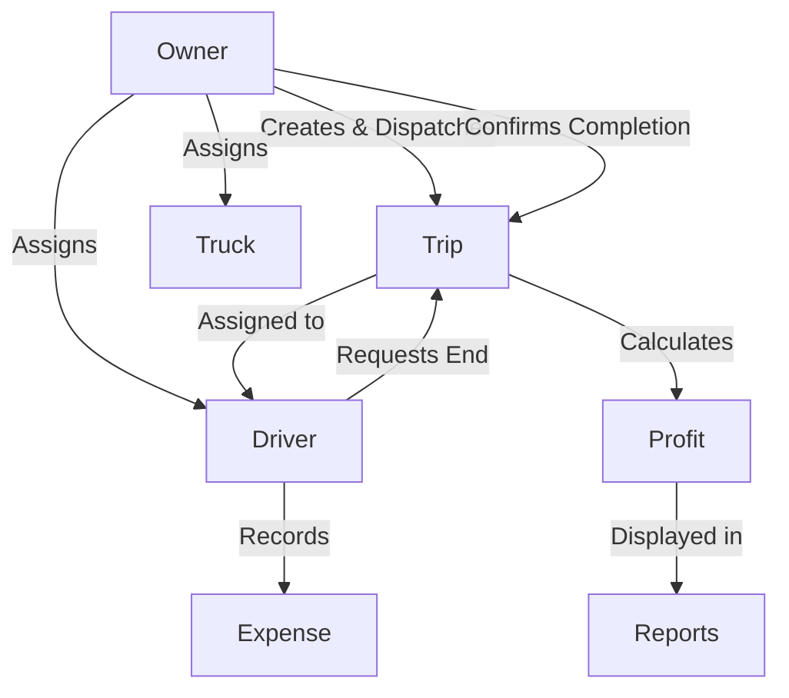
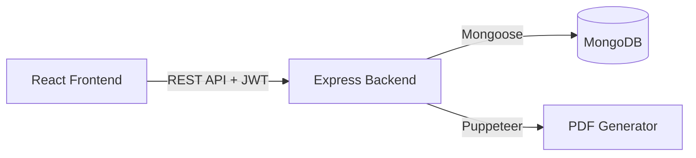
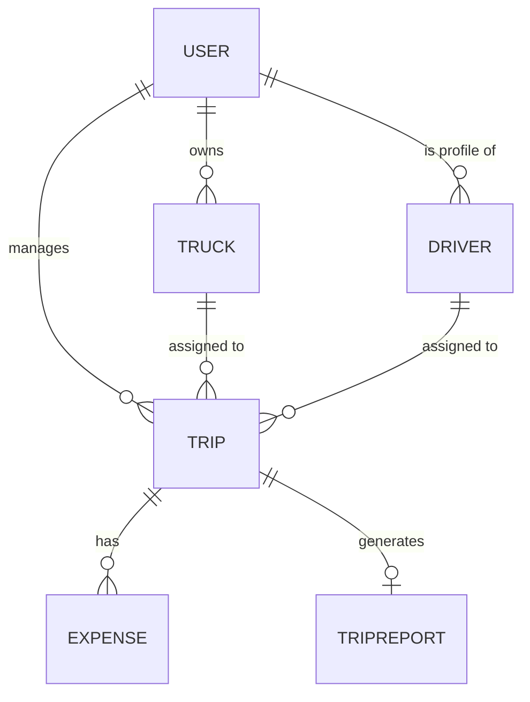

# LogiBrain (formerly FleetFlow) - Complete Technical Documentation

## 1. Project Overview
**LogiBrain** is a comprehensive fleet and logistics management system designed for transport business owners to track trucks, drivers, trips, expenses, and profitability in real time. It replaces manual paperwork with a centralized digital solution.

The system caters to two main users:
- **Owners**: Manage the entire fleet, dispatch trips, and monitor financial reports.
- **Drivers**: Use a mobile-friendly dashboard to view their active assignments, record expenses, and request trip completions.

### High-level Workflow


---

## 2. Problem Statement
Many small to medium logistics and transport companies rely on phone calls, WhatsApp messages, and physical ledgers to track where trucks are, who is driving them, and how much was spent on fuel or tolls. This leads to missing receipts, inaccurate profit calculations, and inefficient fleet utilization. LogiBrain solves this by digitizing the entire dispatch and expense reporting workflow, providing real-time financial visibility.

---

## 3. Project Objectives
**Current Functionality:**
- Manage trucks (add, update, view status).
- Manage drivers (register, view status, assign to trucks).
- Create and dispatch trips (source, destination, expected revenue, material).
- Record expenses against trips (fuel, tolls, food, etc.).
- Driver dashboard for active trip visibility and expense reporting.
- Dashboard analytics (gross revenue, expenses, net profit, margin).
- Trip history and PDF report generation.

**Planned/Future Functionality:**
- Real-time GPS tracking.
- Driver salary calculation.
- Automated maintenance reminders.
- AI Business Assistant.

---

## 4. User Roles

| Role | Purpose | Permissions |
|------|---------|-------------|
| **OWNER** | Admin of the logistics business. | View, create, update, delete trucks, drivers, trips, and expenses. View full analytics and generate reports. Confirm trip completions. |
| **DRIVER** | Operates the truck and executes the trip. | View their own profile, current active trip, and trip history. Record expenses. Request trip completion (`DRIVER_ENDED`). |

---

## 5. Complete Feature List

- **Authentication**: JWT-based login for owners and drivers. (Backend: `authController`, Frontend: `AuthContext`).
- **Truck Management**: Add, edit, list trucks and update statuses (ACTIVE, MAINTENANCE, etc.). (Backend: `truckController`).
- **Driver Management**: Register drivers, view profiles. (Backend: `driverController`).
- **Trip Dispatch**: Create trips linking a truck and a driver. (Backend: `tripController`, UI: `Trips.jsx`).
- **Expense Tracking**: Add expenses with categories (Fuel, Toll, etc.) linked to trips. (Backend: `expenseController`).
- **Driver Dashboard**: Mobile-optimized view showing the current active trip and a button to record expenses or request trip end. (UI: `DriverDashboard.jsx`).
- **Owner Dashboard**: KPI cards showing total revenue, expenses, net profit, and active trips. (UI: `OwnerDashboard.jsx`, Backend: `reportController`).
- **Reports & Analytics**: Advanced filtering for trips and expenses, calculating margins. Generate trip-specific PDF reports. (UI: `Reports.jsx`, Backend: `reportController`).

---

## 6. Technology Stack

**Frontend:**
- **React + Vite**: Fast, modern frontend framework.
- **Tailwind CSS**: Utility-first styling for quick, responsive UI.
- **React Router**: Client-side routing.
- **Axios**: HTTP client for API requests.
- **Recharts**: For rendering analytical charts on the dashboard.
- **Lucide / Google Material Symbols**: Iconography.

**Backend:**
- **Node.js + Express**: Scalable server environment.
- **MongoDB + Mongoose**: NoSQL database for flexible data storage.
- **JSON Web Tokens (JWT)**: Stateless authentication.
- **Puppeteer / Handlebars**: For generating PDF reports (`tripPdfBuilder.js`).
- **Multer**: For handling file uploads (e.g., receipts).

---

## 7. System Architecture


Data flows from the React frontend via Axios to Express routes. Routes use middleware (`authenticate`, `authorize`, `scopeOwnership`) to validate tokens and permissions before passing data to controllers. Controllers interact with Mongoose models, process business logic, and return JSON.

---

## 8. Complete Folder Structure

**Frontend (`frontend/`)**
- `src/api/` - Axios configuration and interceptors (`axiosClient.js`).
- `src/context/` - Global state (`AuthContext.jsx`).
- `src/pages/`
  - `owner/` - Owner specific pages (`OwnerDashboard.jsx`, `Trucks.jsx`, `Drivers.jsx`, `Trips.jsx`, `Expenses.jsx`, `Reports.jsx`).
  - `driver/` - Driver specific pages (`DriverDashboard.jsx`).
  - `auth/` - Login/Registration.

**Backend (`backend/`)**
- `controllers/` - Request handlers containing business logic.
- `middleware/` - Auth (`authenticate.js`), Roles (`authorize.js`), Data Isolation (`scopeOwnership.js`).
- `models/` - Mongoose schemas (`Trip.js`, `Expense.js`, etc.).
- `routes/` - Express route definitions.
- `services/` - External services (`uploadService.js`, `tripReportService.js`).
- `utils/` - Utilities like PDF builders (`tripPdfBuilder.js`).

---

## 9. Frontend Architecture
The frontend is a React SPA using Vite. 
- **State Management**: React Context (`AuthContext`) manages user authentication state globally. Local component state (via `useState`, `useEffect`) handles data fetching.
- **Routing**: Handled by `react-router-dom`. Protected routes redirect unauthorized users.
- **Layouts**: Owner pages share a common layout with a SideNavBar and TopNavBar, while the Driver page is a mobile-first single view.

---

## 10. Backend Architecture
The Express app (`app.js`) mounts routes from the `routes/` folder.
**Lifecycle of a Request:**
1. **Route**: e.g., `GET /api/trips`
2. **Middleware**: `authenticate` checks JWT. `scopeOwnership` appends `ownerId` to queries to isolate data per business.
3. **Controller**: `getTrips` fetches data from MongoDB.
4. **Response**: JSON sent back to the client.

---

## 11. Database Architecture

| Collection | Purpose | Important Fields |
|------------|---------|------------------|
| **Users** | Auth & profiles | `role` (OWNER/DRIVER), `email`, `phone`, `passwordHash`, `businessName`, `businessAddress`, `gstNumber`, `ownerId` (for drivers) |
| **Trucks** | Fleet assets | `registrationNumber` (Unique), `status` (ACTIVE, ON_TRIP, MAINTENANCE) |
| **Drivers**| Driver details | `userId` (Ref: User), `licenseNumber`, `status` |
| **Trips** | Dispatch jobs | `truckId`, `driverId`, `source`, `destination`, `expectedRevenue`, `actualRevenue`, `advanceAmount`, `material`, `quantity`, `startDate`, `status` |
| **Expenses**| Trip costs | `tripId`, `category` (Fuel, Toll, etc.), `amount`, `date`, `receiptUrl` (Uploaded file) |
| **TripReports**| Cached financials | `grossRevenue`, `totalExpenses`, `netProfit` |

---

## 12. Database Relationships



---

## 13. Authentication & Authorization
- **Login Flow**: Client sends email/password. Server verifies and returns a JWT. Client stores JWT in `localStorage`.
- **Authorization**: The `authorize(role)` middleware checks `req.user.role`.
- **Scope Ownership**: `scopeOwnership.js` ensures an OWNER only sees their own trucks/trips by appending `req.scopedQuery = { ownerId: req.user._id }`.

---

## 14. Trip Management
**Lifecycle:**
1. **Create**: Owner selects Truck and Driver, adds route and expected revenue. (Status: `ACTIVE`).
2. **Execution**: Driver sees the trip in their dashboard. Truck and Driver status change to `ON_TRIP`.
3. **End Request**: Driver clicks "Request Trip End". (Status: `DRIVER_ENDED`).
4. **Completion**: Owner reviews expenses and confirms. (Status: `COMPLETED`). Truck/Driver become `ACTIVE` again. A `TripReport` is generated.

*(File: `backend/controllers/tripController.js`)*

---

## 15. Expense Management
Expenses can be added by the Owner or the Driver (during an active trip).
**Categories:** Fuel, Toll, Food, Parking, Repair, Loading/Unloading, Insurance/Permit, Other.
Expenses are strictly tied to a `tripId`. They immediately affect the real-time profit calculations. 
The system also supports uploading image receipts using `multer` (`uploadService.js`), storing the resulting `receiptUrl`.

*(File: `backend/controllers/expenseController.js`)*

---

## 16. Revenue & Profit Logic
Calculations are processed dynamically in `reportController.js` and finalized in `tripReportService.js`.
- **Gross Revenue**: `trip.actualRevenue` (if set) or `trip.expectedRevenue`.
- **Total Expenses**: Sum of all `Expense` amounts for that trip.
- **Net Profit**: `Gross Revenue - Total Expenses`.
- **Profit Margin**: `(Net Profit / Gross Revenue) * 100`.

---

## 17. Dashboard (Owner)
Displays KPIs:
- **Total Revenue & Expenses**: Aggregated from `TripReports`.
- **Active Trips**: Count of trips with status ACTIVE or DRIVER_ENDED.
- **Charts**: Uses `recharts` to plot revenue vs expenses.

---

## 18. Driver Dashboard
A mobile-first UI (`DriverDashboard.jsx`).
- **Profile Summary**: Status, License.
- **Current Assignment**: Source, Destination, Material.
- **Actions**: "Add Expense" (opens a highly visual modal with icons for categories), "Request Trip End".
- **History**: Modal showing past completed trips.

---

## 19. Owner/Admin Dashboard
Provides full CRUD interfaces for Trucks, Drivers, Trips, and Expenses via side-navigation. Advanced filtering by date and entity is provided in the Reports tab.

---

## 20. Reports
The Reports page allows Owners to view detailed analytics.
- Features date filtering.
- Displays breakdown of expenses by category (e.g., how much was spent on Fuel overall).
- Allows generating and downloading PDF trip reports (via Puppeteer).

---

## 21. API DOCUMENTATION

**Auth Routes (`/api/auth`)**
- `POST /register-owner` - Register new owner.
- `POST /login` - User login.
- `POST /refresh` - Refresh token.
- `POST /logout` - User logout.
- `GET /me` - Get current user profile.

**Truck Routes (`/api/trucks`)** *(Auth: OWNER)*
- `POST /` - Create truck.
- `GET /` - List trucks.
- `GET /:id` - Get truck details.
- `PUT /:id` - Update truck.
- `PATCH /:id/status` - Update truck status.
- `GET /:id/history` - Get truck trip history.

**Driver Routes (`/api/drivers`)** *(Auth: OWNER)*
- `POST /` - Create driver.
- `GET /` - List drivers.
- `GET /:id` - Get driver details.
- `PUT /:id` - Update driver.
- `PATCH /:id/status` - Update driver status.

**Trip Routes (`/api/trips`)**
- `POST /` - Create a trip. (Auth: OWNER)
- `GET /` - List trips. (Auth: Scoped)
- `GET /history` - Get past trips. (Auth: Scoped)
- `GET /:id` - Get trip details.
- `PATCH /:id/confirm-end` - Owner confirms completion. (Auth: OWNER)
- `PATCH /:id/cancel` - Cancel a trip, reverts truck/driver to ACTIVE. (Auth: OWNER)
- `DELETE /:id` - Delete a trip. (Auth: OWNER)
- `PATCH /:id/end` - Driver requests trip completion. (Auth: DRIVER)

**Expense Routes (`/api/expenses`)**
- `POST /` - Record expense (supports `receipt` upload). (Auth: Scoped)
- `GET /` - List expenses for a trip.
- `GET /:id` - Get single expense.
- `DELETE /:id` - Delete expense. (Auth: OWNER)

**Report Routes (`/api/reports`)**
- `GET /dashboard` - Dashboard KPIs. (Auth: OWNER)
- `GET /truck/:truckId` - Truck financials. (Auth: OWNER)
- `GET /overall` - Aggregate financial report. (Auth: OWNER)
- `GET /analytics` - Advanced analytics. (Auth: OWNER)
- `GET /trip/:tripId` - Get single trip report.
- `GET /trip/:tripId/pdf` - Download PDF report.
- `GET /driver/:driverId` - Driver financial report.

---

## 22. API FLOW EXAMPLES
**Record Expense (Driver):**
1. Frontend `DriverDashboard.jsx` POSTs to `/api/expenses`.
2. Backend `expenseRoutes.js` applies `authenticate` middleware.
3. `expenseController.js` creates an `Expense` document linked to the `tripId`.
4. DB saves. Returns `201 Created`.
5. Frontend refetches expenses to update UI.

---

## 23. Validation Rules
- **Backend Validation**: Mongoose schema enums (e.g., Truck status must be ACTIVE, INACTIVE, MAINTENANCE, ON_TRIP).
- **Frontend Validation**: HTML5 validations (`required`, `min="1"` for amounts).
- **Business Rule**: A Truck or Driver cannot be assigned a new trip if their status is `ON_TRIP`.

---

## 24. Error Handling
- **Backend**: Express error handler (`errorHandler.js`) catches async errors and returns formatted JSON `{ success: false, message: "..." }`.
- **Frontend**: API calls use `try/catch`. Errors are displayed in UI banners or alerts.

---

## 25. Environment Variables
Create a `.env` in the `backend/` folder:
- `PORT=5000`
- `MONGO_URI=your_mongodb_connection_string`
- `JWT_SECRET=your_jwt_secret_key`

Create a `.env` in `frontend/`:
- `VITE_API_URL=http://localhost:5000/api`

---

## 26. Local Development Setup
1. **Clone project**
2. **Backend Setup**:
   ```bash
   cd backend
   npm install
   # Create .env file based on .env.example
   npm run dev
   ```
3. **Frontend Setup**:
   ```bash
   cd frontend
   npm install
   # Create .env with VITE_API_URL
   npm run dev
   ```
4. Access app at `http://localhost:5173`.

---

## 27. Development Workflow
1. Pull latest code.
2. Ensure MongoDB is running locally or remotely.
3. Start both servers (`npm run dev`).
4. Modify React components in `frontend/src/` or APIs in `backend/`.
5. Check browser console and terminal for errors.

---

## 28. Common Problems & Solutions
- **CORS Error**: Ensure `backend/app.js` has `cors()` enabled for the frontend port (5173).
- **JWT Expired**: Log out and log back in.
- **Driver cannot see trip**: Ensure the trip status is `ACTIVE` and assigned to that specific `driverId`.

---

## 29. Important Business Rules
- A Driver can only have ONE active trip at a time.
- Expenses MUST belong to a valid `tripId`.
- Only Owners can register Drivers and Trucks.
- When a trip is completed, the system automatically sets the Truck and Driver status back to `ACTIVE`.

---

## 30. Planned AI Business Assistant
**[PLANNED / FUTURE FUNCTIONALITY]**
Future integration will include an AI Chat service that reads `LogiBrain` database analytics and provides business insights.
*Example queries*: "Which truck has the highest fuel cost?", "Compare this month's profit with last month."
*(Not verified from the current codebase. This is a planned feature).*

---

## 31. Future Roadmap
**CURRENT**: Core trip dispatch, expense recording, basic PDF reporting, driver dashboard.
**PLANNED**: AI Assistant, Driver payroll/salary tracking, automated maintenance alerts.

---

## 32. Team Member Quick Start
**How to understand this project in 30 minutes:**
1. **Start Here**: Look at `backend/models/Trip.js` and `Expense.js`. These are the core entities.
2. **Frontend Entry**: Read `frontend/src/pages/owner/Trips.jsx` to see how trips are displayed.
3. **Business Logic**: Look at `backend/controllers/tripController.js` to see how trips are created and completed.
4. **Test it**: Register an owner account, add a truck, add a driver, create a trip, and log in as the driver to view it.

---

## 33. Glossary
- **Trip/Dispatch**: A job assigning a truck and driver to move material from source to destination.
- **KPI**: Key Performance Indicator (e.g., Net Profit).
- **Owner**: The transport company administrator.

---

## 34. FAQ
- **Where is the database connection?** `backend/config/db.js`.
- **Where is profit calculated?** `backend/controllers/reportController.js` and `backend/services/tripReportService.js`.
- **How does the driver receive a trip?** The `DriverDashboard.jsx` fetches `GET /api/trips?status=ACTIVE` which the backend filters by the logged-in driver's ID.
